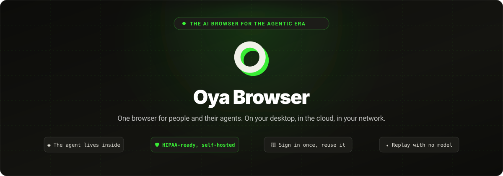
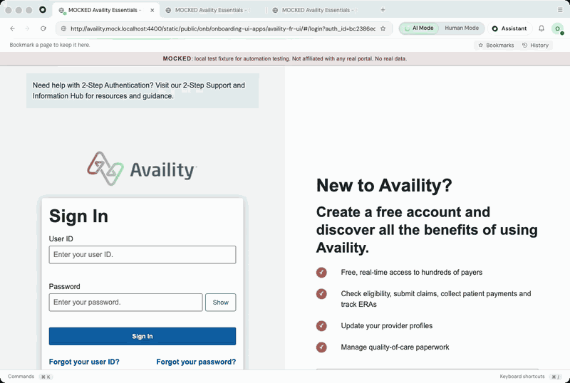

<p align="center">
  
</p>

<h3 align="center">The browser for regulated industries (community version).</h3>

<p align="center">
  People and AI agents work together in one browser, with control over where it runs and how it is governed.
</p>

<p align="center">
  <a href="https://oyabrowser.com/#download"><strong>Download Oya Browser</strong></a> ·
  <a href="https://oyabrowser.com">Get started in the cloud</a> ·
  <a href="docs/self-hosting.md">Self-host Oya</a> ·
  For enterprise, <a href="mailto:sales@getoya.ai">contact sales@getoya.ai</a>
</p>

<p align="center">
  <a href="https://github.com/OyadotAI/oya-browser/releases/latest"></a>
  <a href="https://www.npmjs.com/package/@oya-ai/browser"></a>
  <a href="https://codecov.io/gh/OyadotAI/oya-browser"></a>
  <a href="LICENSE.md"></a>
  <a href="https://discord.gg/wqSeXJPygn"></a>
</p>

<p align="center">
  
</p>
<p align="center"><sub>A run in the Oya desktop app, sped up. The portal and patient data are fictional. Watch <a href="assets/prior-auth-1.mp4">run 1</a> · <a href="assets/prior-auth-2.mp4">run 2</a> · <a href="assets/prior-auth-3.mp4">run 3</a>.</sub></p>

This repository contains the **Oya Browser community edition**. People and AI agents work
together in one browser: agents can use an existing signed-in browser, start managed cloud
browsers, or connect through familiar tools and APIs. People can watch the work, step in when
needed, and keep control of browser access and repeatable tasks.

The **enterprise edition, including the HIPAA-ready offering, is maintained in a separate private
repository**. Contact [sales@getoya.ai](mailto:sales@getoya.ai) to learn about that edition.

## Choose how to get started

### Use Oya with an AI assistant

Install the [desktop app](https://oyabrowser.com/#download), sign in, and connect your assistant
from the app. Oya works with Claude Code, Codex, Cursor and VS Code. People can see the agent's
browser activity and take control when a task needs their attention.

[Download the desktop app](https://oyabrowser.com/#download) · [Agent setup guide](https://oyabrowser.com/llms.txt)

### Control a browser from Node.js

Install the SDK and create an API key at [oyabrowser.com](https://oyabrowser.com). Node.js 20 or
newer is required.

```bash
npm install @oya-ai/browser
```

Set `OYA_API_KEY`, then run:

```js
import { Oya } from '@oya-ai/browser';

const oya = new Oya();
const browser = await oya.browser.start();

try {
  await browser.goto('https://news.ycombinator.com');
  console.log(await browser.ask('Summarize the top three stories.'));
} finally {
  await browser.stop();
}
```

With no browser provider configured, `start()` can use the Oya desktop browser already connected
to your account. To start cloud or self-hosted browsers, configure a provider with
[`npx @oya-ai/cli init`](packages/cli/README.md). The SDK and CLI can also use Browserbase, Steel,
Anchor, Browser Use, or a browser you provide. Your application can keep the same SDK calls when
you change providers.

[SDK guide](packages/sdk/README.md) · [Runnable examples](examples/README.md) · [CLI guide](packages/cli/README.md)

### Connect over MCP

For assistants that support remote MCP, connect to `https://oyabrowser.com/mcp/pool` and
authenticate with your Oya API key. For Claude Code:

```bash
claude mcp add --transport http oya https://oyabrowser.com/mcp/pool \
  --header "Authorization: Bearer $OYA_API_KEY"
```

Use the same endpoint with your self-hosted server URL when you run your own deployment.

[Agent instructions and MCP reference](https://oyabrowser.com/llms.txt)

### For AI agents

Use the [agent reference](https://oyabrowser.com/llms.txt) for setup instructions, available
tools, SDK examples, and MCP configuration. The desktop app can pair with Claude Code, Codex,
Cursor, and VS Code. For remote MCP clients, connect to `https://oyabrowser.com/mcp/pool` with
your Oya API key.

### Run Oya in your own environment

Use the installer to set up a self-hosted instance:

```bash
curl -fsSL https://raw.githubusercontent.com/OyadotAI/oya-browser/main/install.sh | sh
```

For production, choose Docker, Amazon ECS, Kubernetes, or GKE. The deployment guides cover
configuration, storage, upgrades, and operations.

[Self-hosting guide](docs/self-hosting.md) · [Deployment templates](deployments/)

## What you can do with Oya

- **Work in a signed-in browser.** Connect the desktop app and reuse logins imported from Chrome,
  Arc, Brave, Edge, or Firefox. [Set up logins](docs/logins.md).
- **Keep a person in control.** Watch an agent work, switch between AI Mode and Human Mode, and
  keep agent activity in its own tabs.
- **Turn a successful run into a playbook.** Replay repeatable tasks with new inputs, inspect the
  generated Playwright module, and export or import workflows.
  [Playbook details](packages/sdk/README.md#portal-automation-record-once-replay-with-new-inputs) ·
  [Replay benchmark](docs/replay-benchmark.md).
- **Choose where browsers run.** Use Oya Cloud, your own deployment, supported browser providers,
  or a browser you provide. [Why route through Oya?](docs/why-oya.md).
- **Operate with governance controls.** Self-hosted community deployments include host egress
  rules and a tamper-evident audit trail. See the [control evidence](compliance/EVIDENCE.md) and
  [trust center](https://oyabrowser.com/trust).

## For contributors

Oya is made up of the browser, control plane, console, SDK, and CLI. Start with the architecture
map, then read the guide for the part you plan to change.

- [Architecture overview](ARCHITECTURE.md)
- [Development setup and commands](#development)
- [Open issues](https://github.com/OyadotAI/oya-browser/issues)
- [Join the community on Discord](https://discord.gg/wqSeXJPygn)

### Development

Requirements and commands vary by project area. See [Working in this repository](AGENTS.md) for
the conventions and complete command list. To install dependencies across the workspace:

```bash
npm run setup
```

Common checks:

```bash
npm run lint
npm run format:check
npm test
```

The full test command builds the SDK and runs the server, CLI, package, and script suites. For
changes in the UI or browser app, run the checks listed in that part's `package.json` and
architecture guide as well.

## Packages and project areas

| Path | What it contains |
| :--- | :--- |
| [`packages/sdk`](packages/sdk) | `@oya-ai/browser`, the TypeScript SDK (MIT) |
| [`packages/cli`](packages/cli) | `@oya-ai/cli`, setup and command-line tools (MIT) |
| [`browser`](browser) | Oya's desktop browser and cloud browser image |
| [`server`](server) | API, browser connections, MCP, and control plane |
| [`ui`](ui) | Web console and public site |
| [`examples`](examples) | SDK and browser integration examples |
| [`docs`](docs) | Operator guides and product details |

## License

The SDK and CLI are MIT licensed. The rest of the project is available under the Sustainable Use
License. See [LICENSE.md](LICENSE.md) for permitted use, self-hosting terms, and commercial
licensing details.
